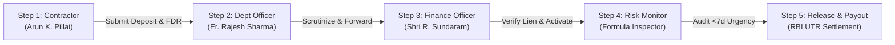

# SD-FDR Smart Portal | Smart India Hackathon 2026

> **National Unified Security Deposit & Fixed Deposit Receipt (FDR) Custody Management System**  
> Built for government departments, public institutions, contractors, vendors, and treasury/finance officers.

---

## 1. Product Vision & Problem Solved

Government departments, PSUs, and municipal corporations handle thousands of physical **Security Deposits (SD)**, **Earnest Money Deposits (EMD)**, and **Fixed Deposit Receipts (FDR)**.

### Critical Pain Points Eliminated:
- **Paperwork & Locked Vaults:** Replaces physical paper FDRs locked in departmental iron safes with a certified digital custody register.
- **Trapped Contractor Working Capital:** Streamlines delayed refunds via an end-to-end transparent clearance workflow.
- **Missed Maturity Dates & Interest Leakage:** Eliminates unmonitored FDRs maturing in commercial banks without timely renewal or encashment.
- **Counterfeit Guarantees:** Replaces unverified paper guarantees with an explicit Bank Verification & Lien marking protocol.
- **Dispute-Prone Manual Records:** Guarantees transparency with an immutable, append-only security audit trail.

---

## 2. SIH 2026 Evaluation Demo Credentials

The portal features an integrated **1-Click Persona Switcher** and a sticky **SIH 2026 Guided Demonstration Sequence Bar** at the top of the app, allowing evaluators to experience role-scoped permissions instantly:

| Persona / Role | Demo User Name | Official Email | Default Password | Scope of Permissions |
|---|---|---|---|---|
| **Super Administrator** | Shri Amitabh Kant | `admin@gov.in` | `GovAdmin@2026` | Full system control, role assignment, system-wide analytics, settings |
| **Department Officer** | Er. Rajesh Kumar Sharma | `officer.pwd@gov.in` | `Officer@2026` | Public Works Dept (PWD) scrutiny, compliance checking, site clearance sign-off |
| **Contractor / Vendor** | Arun K. Pillai | `contractor@ltinfra.com` | `Vendor@2026` | L&T Infra submissions, receipt uploads, renewal & refund applications |
| **Finance / Accounts Officer** | Shri R. Sundaram | `finance@gov.in` | `Finance@2026` | Treasury controller, bank lien verification, RBI e-Kuber UTR release, forfeiture execution |
| **Auditor (CAG)** | Ms. Sunita Roy | `auditor@cag.gov.in` | `Auditor@2026` | Comptroller & Auditor General read-only scrutiny, audit logs, CSV exports |

---

## 3. Recommended 5-Minute Evaluator Demonstration Sequence

Evaluators can follow this sequence using the guided walkthrough bar or the persona switcher:



1. **Step 1 — Contractor Application (`/deposits?openModal=true`):**
   - Click **Step 1: Contractor Submission** in the top tour bar (switches persona to Arun K. Pillai).
   - Enter reference `SBI-FDR-9844210` to observe the real-time **Duplicate Record Detection Engine** alert.
   - Enter a unique reference (e.g. `SBI-FDR-2026-DEMO`) and submit.
2. **Step 2 — Department Scrutiny (`/deposits/:id`):**
   - Click **Step 2: Dept Officer** (switches persona to Er. Rajesh Kumar Sharma).
   - Inspect the **Unified Visual Lifecycle Progression Stepper** and **Document Completeness Checklist**.
   - Click **Start Dept Scrutiny**, enter remarks, and click **Forward to Finance**.
3. **Step 3 — Finance Verification & Bank Lien (`/fdrs`):**
   - Click **Step 3: Finance Officer** (switches persona to Shri R. Sundaram).
   - Review pending FDRs, verify the branch confirmation letter, and click **Confirm Bank Lien & Activate**.
4. **Step 4 — Smart Maturity Risk Monitor (`/risk-monitor`):**
   - Inspect the ranked matrix and click on any risk score to open the **Transparent Formula Breakdown** (`Time + Exposure + Lien = Total Score / 100`).
   - Review the **SLA & Processing Turnaround Time Analytics** on the dashboard.
5. **Step 5 — Dual-Level Release & Treasury Settlement (`/releases`):**
   - Initiate a release request, approve department site clearance, and enter an RBI e-Kuber UTR reference to settle.
   - Switch to **Auditor (CAG)** and inspect the append-only **Security Audit Trail** (`/audit-logs`) to verify tamper-evident logging.

---

## 4. Transparent Maturity-Risk Scoring Formula

Every Fixed Deposit Receipt is scored on three objective, audit-compliant components:

$$\text{Composite Risk Score (0-100)} = \text{Time Urgency} + \text{Capital Exposure} + \text{Lien Deficiency}$$

| Component | Point Range | Transparent Scoring Rules |
|---|---|---|
| **1. Time Horizon Urgency** | **0 to 60 pts** | Matured / Expired: **60 pts**<br>Critical Horizon (&le; 7 days): **50 pts**<br>Warning Horizon (&le; 30 days): **35 pts**<br>Quarterly Horizon (&le; 90 days): **15 pts**<br>Safe Horizon (&gt; 90 days): **5 pts** |
| **2. Capital Exposure** | **0 to 25 pts** | Principal &ge; ₹2.00 Cr: **25 pts**<br>Principal ₹1.00 Cr &ndash; ₹2.00 Cr: **18 pts**<br>Principal ₹50 Lakh &ndash; ₹1.00 Cr: **10 pts**<br>Principal &lt; ₹50 Lakh: **5 pts** |
| **3. Bank Lien Deficiency** | **0 to 15 pts** | Unverified / Missing Branch Confirmation: **+15 penalty pts**<br>Official Bank Lien Verified: **0 pts penalty** |

---

## 5. Automated Evaluation Test Suite

To verify all 32 unit, lifecycle, and security authorization assertions against the live backend:

```bash
cd "C:\Users\SHIVAM DHENGLE\.gemini\antigravity\scratch\sd-fdr-portal"
node tests/lifecycle.test.js
```

### Verified Test Results:
```
===============================================================
  SIH 2026 EVALUATION TEST SUITE: SD-FDR SMART PORTAL
===============================================================

[1/7] Testing Core Master Data & Initial State...
  ✓ PASS: Server responds on /api/auth/me with HTTP 200
  ✓ PASS: All 5 stakeholder roles are registered
  ✓ PASS: 5 Ministries/Departments are seeded

[2/7] Testing Duplicate Record Detection Engine...
  ✓ PASS: Duplicate check responds with HTTP 200
  ✓ PASS: Successfully detects existing FDR receipt number collision
  ✓ PASS: Correctly flags collision severity as CRITICAL

[3/7] Testing Document Completeness Rules Validator...
  ✓ PASS: Completeness engine responds with HTTP 200
  ✓ PASS: Checklist generated with mandatory attachment rules

[4/7] Testing Smart Maturity Risk Monitor Formula...
  ✓ PASS: Risk monitor endpoint returns HTTP 200
  ✓ PASS: Risk items are ranked and available
  ✓ PASS: FDR includes transparent risk breakdown object
  ✓ PASS: Time urgency component calculated (0-60 pts)
  ✓ PASS: Capital exposure component calculated (0-25 pts)
  ✓ PASS: Bank lien deficiency penalty calculated (0-15 pts)

[5/7] Testing SLA Turnaround & Overdue Tracking...
  ✓ PASS: SLA analytics endpoint returns HTTP 200
  ✓ PASS: Target SLA baseline set to 7 days
  ✓ PASS: All 5 departments have SLA compliance ratings

[6/7] Testing Full 8-Stage Deposit Lifecycle...
  ✓ PASS: Contractor successfully submits new deposit (HTTP 201)
  ✓ PASS: Deposit created with status SUBMITTED
  ✓ PASS: Dept Officer transitions deposit to DEPT_REVIEW
  ✓ PASS: Dept Officer forwards to FINANCE_VERIFICATION
  ✓ PASS: Finance Officer marks bank lien as verified
  ✓ PASS: Finance Officer transitions deposit to ACTIVE
  ✓ PASS: Contractor initiates release request (HTTP 201)
  ✓ PASS: Department Officer signs off site clearance
  ✓ PASS: Finance Officer processes settlement with UTR
  ✓ PASS: Linked deposit automatically transitioned to RELEASED
  ✓ PASS: Deposit transitioned to CLOSED

[7/7] Testing Security RBAC Boundaries & Audit Trail...
  ✓ PASS: Contractor attempting illegal transition is rejected with HTTP 403 Forbidden
  ✓ PASS: Auditor attempting to create record is rejected with HTTP 403 Forbidden
  ✓ PASS: Audit trail contains all lifecycle events
  ✓ PASS: Entity audit logs captured submission, approvals, and releases immutably

===============================================================
  TEST RESULTS: 32/32 TESTS PASSED (100% SUCCESS)
===============================================================
```

---

## 6. Setup & Execution Instructions

### Run Full-Stack Development Mode:
```bash
npm run dev
```
- Express Backend API: `http://localhost:5000`
- Vite React Client: `http://localhost:5173`

### Run Single-Port Unified Production Mode:
```bash
npm run build
npm start
```
- Access complete portal on: `http://localhost:5000`

---

## 7. Financial & Integration Integrity Disclaimer

> [!NOTE]
> Bank SFMS transmission confirmations, RBI e-Kuber treasury gateways, and SMS/email delivery mechanisms in this prototype are realistic software simulations using seeded government data structures. No live banking credentials or actual monetary transfers are simulated or claimed to be live third-party connections.
